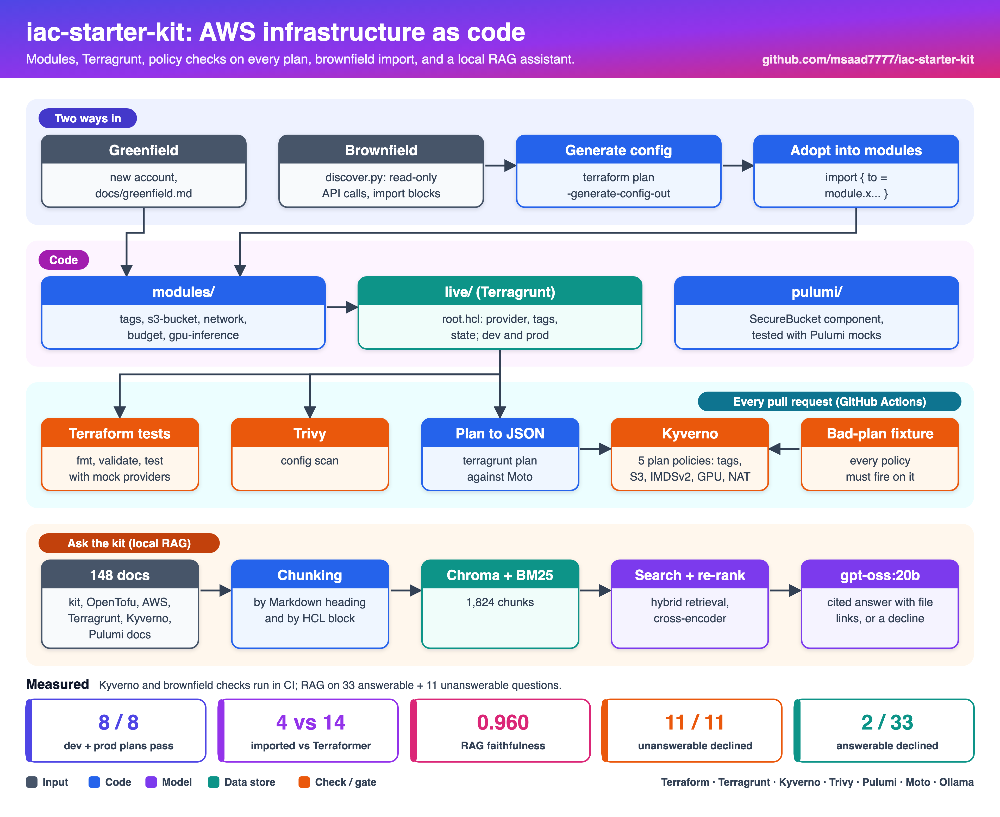
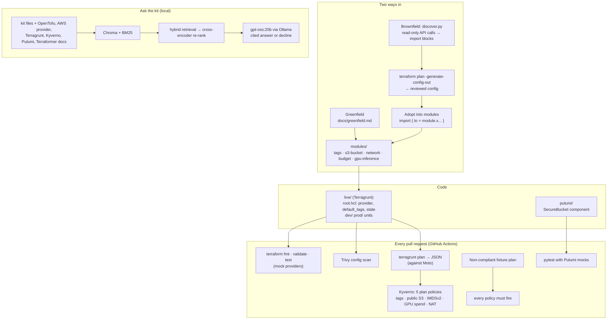

# IaC starter kit for AWS: FinOps and AI infrastructure

A free, opinionated starting point for teams adopting infrastructure as code on AWS, whichever way they arrive:

- **Greenfield:** no IaC yet. Agree tags, set up state, then build from tested modules with Terragrunt.
- **Brownfield:** resources were made by hand (ClickOps) or by old scripts. Discover them, import them with zero changes, then adopt them into the standard modules.

Cost control and GPU inference are built in, not bolted on. Kyverno policies check every Terraform plan before apply. A small RAG assistant answers questions about the kit and the tools it uses, with citations.

Everything runs locally against [Moto](https://github.com/getmoto/moto), a local AWS mock. **You need no AWS account, API key or paid service to try any of it**, and CI runs the same way.

| Tool | Used for |
|---|---|
| Terraform 1.11 | five tested modules (`terraform test` with mock providers) |
| Terragrunt 1.2 | dev and prod live layout, DRY provider, tags and state |
| Kyverno 1.20 | 5 policies on Terraform plan JSON, 3 on Kubernetes manifests |
| Terraform `import` blocks | brownfield discovery and adoption |
| Terraformer | bulk export, tested and documented (the project is archived) |
| Pulumi (Python) | the same secure bucket as a component, with unit tests on mocks |
| Trivy | misconfiguration scan in CI |
| LangChain, Chroma, Ollama | "Ask the kit" assistant, local models only |

## Architecture



<details>
<summary>Same diagram as text (Mermaid)</summary>



</details>

## What's in the kit

### Modules (`modules/`)

| Module | What it does | Tests |
|---|---|---|
| `tags` | standard tag set with validation: `cost-center` must look like `CC-1234`, environment must be dev, staging or prod, extra tags can't override the standard keys | 4 |
| `s3-bucket` | public access blocked, bucket-owner ownership, SSE-S3 or KMS with bucket keys, versioning, lifecycle (Intelligent-Tiering after 30 days, old versions expire), TLS-only policy | 4 |
| `network` | VPC across 1–4 AZs, public and private subnets, NAT strategy `none`, `single` or `per_az`, free S3 and DynamoDB gateway endpoints, optional flow logs to S3 | 5 |
| `budget` | monthly AWS Budget filtered by cost centre, alerts at 80 % actual and 100 % forecast, optional Cost Anomaly Detection | 4 |
| `gpu-inference` | spot-first GPU Auto Scaling group across g6, g5 and g4dn, IMDSv2, encrypted gp3, optional office-hours scale-to-zero, tags that reach the instances | 6 |

All 23 tests use `mock_provider`, so `terraform test` needs no cloud credentials.

### Live layout (`live/`)

Terragrunt keeps the provider, default tags and state in one place (`root.hcl`). Each unit lists only what differs per environment:

| Unit | dev | prod |
|---|---|---|
| `network` | 2 AZs, one shared NAT gateway | 3 AZs, a NAT gateway per AZ |
| `assets-bucket` | old versions kept 14 days | old versions kept 90 days |
| `budget` | $300 a month | $2,000 a month plus anomaly detection |
| `llm-inference` | at most 1 GPU instance, scaled to zero outside 08:00–19:00 on weekdays | 1 on-demand instance always on, up to 4 |

State is local by default. `KIT_BACKEND=s3 KIT_STATE_BUCKET=<bucket>` switches to the S3 backend with native lock files (`use_lockfile`), so no DynamoDB table is needed.

### Policies (`policies/`)

Kyverno `ValidatingPolicy` resources. The Terraform ones read `terraform show -json` output, so they work on any plan, not only Terragrunt's.

| Policy | Checks |
|---|---|
| `require-finops-tags` | every taggable resource has `cost-center`, `owner` and `environment`; Auto Scaling groups propagate `cost-center` |
| `s3-block-public-access` | every bucket has all four public access block settings on |
| `require-imdsv2` | launch templates and instances require IMDSv2 tokens |
| `gpu-spend-guardrails` | GPU groups are at most 50 % on-demand above the base; dev GPU groups have a scale-to-zero schedule |
| `dev-nat-gateway-limit` | at most one NAT gateway outside prod |
| `require-cost-labels` (K8s) | workloads carry `cost-center` and `team` labels |
| `gpu-workload-guardrails` (K8s) | GPU requests equal limits; GPU pods go to spot nodes unless marked critical |
| `require-pinned-images` (K8s) | no `:latest` or untagged images |

CI checks both directions: all 8 dev and prod plans pass every policy, and a deliberately non-compliant plan (`policies/terraform/tests/noncompliant`) makes every policy fail. The Kubernetes policies have 15 `kyverno test` cases.

### Guides (`docs/`)

- [greenfield.md](docs/greenfield.md): tags first, state second, layout, rollout order.
- [brownfield.md](docs/brownfield.md): discover, import with zero changes, adopt into modules; Terraformer compared.
- [finops.md](docs/finops.md): cost defaults in the modules, budgets as code, policies that block waste.
- [ai-infrastructure.md](docs/ai-infrastructure.md): GPU inference on EC2 and guardrails for GPU workloads on Kubernetes.

## Brownfield, measured

`scripts/brownfield-demo.sh` seeds Moto with a "ClickOps" estate (a bucket, a VPC, a subnet and a security group with port 443 open to the world), then:

1. `discover.py` writes 4 import blocks, skipping the default VPC and default security groups.
2. Terraform's generated config is reviewed into `legacy.tf`. Plan: **4 to import, 0 to add, 0 to change, 0 to destroy.**
3. The bucket is adopted into the `s3-bucket` module. Plan: **1 to import, 6 to add, 1 to change, 0 to destroy.** The 6 additions are the hardening it was missing; the change is the FinOps tags.

The script fails if either summary changes, and CI runs it on every push.

Terraformer, run on the same estate, exported 14 resources instead of 4 (the default VPC, its 6 subnets and 2 default security groups came along), with names like `tfer--subnet-1bf5f134aebbf7561`. Details are in [brownfield.md](docs/brownfield.md).

## Ask the kit

`assistant/` is a RAG assistant over the kit's own files and the open-licensed docs of the tools it uses. It answers with numbered citations that link to the exact file, or declines when the sources don't cover the question.

```text
$ kit-assistant ask "How can the S3 backend lock state without a DynamoDB table?"
The S3 backend can lock state by using a lock file stored in the same bucket.
When `use_lockfile = true` is set, OpenTofu/Terraform performs conditional writes with an
`If-None-Match` header, creating a lock object in the bucket that protects the state file.
This native S3 locking mechanism removes the need for a DynamoDB lock table. [1][2]
  [1] IaC starter kit: docs/greenfield.md
  [2] OpenTofu docs: website/docs/language/settings/backends/s3.mdx

$ kit-assistant ask "What is the capital of Australia?"
The kit and the docs it indexes do not cover that question.
  (declined: retrieval_gate (top rerank score -11.18))
```

It uses the same pipeline as [mars-rag](https://github.com/msaad7777/mars-rag), and runs locally on free models:

- **Retrieval:** dense (bge-small through FastEmbed) and BM25 search, fused by reciprocal rank.
- **Re-ranking:** a cross-encoder picks the top 5.
- **Generation:** gpt-oss:20b through Ollama.
- **Three decline gates:**
  1. a low re-rank score;
  2. the model saying the context is insufficient;
  3. no valid citation.

What's different here:

- **Chunking follows the structure.**
  - Markdown is split by heading with a small custom splitter, because LangChain's header splitter strips the indentation that YAML and HCL examples depend on.
  - `.tf` and `.hcl` files are split at `resource`, `module` and `variable` blocks.
- **Citations point to files.** Each chunk keeps its repo, path and section, so `[2]` links to the exact doc at the pinned commit.

### Results

Measured on 33 answerable and 11 unanswerable questions. The corpus is 148 documents, split into 1,824 chunks. Every number comes from [`assistant/eval/results/`](assistant/eval/results).

| Metric | Result |
|---|---|
| RAGAS faithfulness | **0.960** |
| RAGAS context precision (with reference) | **0.825** |
| RAGAS context recall | **0.898** |
| Citation accuracy (cited passage supports the sentence) | **0.811** (53 citations checked) |
| Unanswerable questions correctly declined | **11 / 11** |
| Answerable questions wrongly declined | **2 / 33** (6.1 %) |
| Latency p50 / p95 (all 44 questions, M4 laptop) | 12.0 s / 20.7 s |

### Retrieval ablation (no LLM, top 5)

A hit means a gold document is in the top 5.

| Mode | Hit@5 | MRR@5 |
|---|---|---|
| Dense only | 0.879 | 0.730 |
| BM25 only | 0.939 | 0.733 |
| Hybrid (RRF) | **1.000** | 0.787 |
| BM25 + re-rank | 0.970 | 0.825 |
| Hybrid + re-rank (used) | 0.970 | **0.829** |

- Hybrid retrieval found a gold document for every question.
- Re-ranking pushed one Terragrunt document out of the top 5, but put the right document higher on average, raising MRR from 0.787 to 0.829.
- Dense retrieval alone missed 2 of the 10 questions about the kit's own files. BM25 matched exact names such as `use_lockfile` and `expose = true`.
- The re-ranker runs on CPU and is the slowest step: 4.2 s per query in this run, 1.6 s in the first run on the same machine.

### Declining

The retrieval gate (a re-rank score below -2.0) declined 5 of the 11 unanswerable questions without calling the model, and blocked no answerable question. The model itself declined the other 6, for example "How do I make Checkov skip a check?" and "What is the default Elastic IP quota?". Those questions are close to the corpus topics, but the corpus doesn't answer them.

A sweep of the gate threshold, from `retrieval.json`:

| Threshold | Answerable blocked | Unanswerable blocked |
|---|---|---|
| -4 | 0 % | 18 % |
| -2 (used) | 0 % | 45 % |
| 1 | 3 % | 55 % |
| 2 | 3 % | 64 % |

### What went wrong in the eval

- **The first run lost 5 answers to citation format.** gpt-oss sometimes cites in its native style, `【3】` or `【3†L5-L9】`. Gate 3 found no `[n]`, so it declined good answers: 6 of 32 answerable questions were wrongly declined in run 1. Those citations are now rewritten to `[n]` before the gates run, with a unit test. Run 2 is the one reported here.
- **One "unanswerable" question was answerable.** "How do I set up Azure Blob Storage as a Terraform backend?" was labelled unanswerable, but run 1 answered it from an `azurerm` example in the Terragrunt docs. It was moved to the answerable set (q33).
- **The 2 remaining wrong declines.**
  - The kit's own "plan without an AWS account" answer had no valid citation. The right files ranked first.
  - The time-zone format for `aws_autoscaling_schedule`: the right passage ranked second, but the model said the context was insufficient.

  Both are safe failures.
- **Citation accuracy is lower than mars-rag's** (0.811 against 0.919). Each cited sentence is checked on its own. Of the 10 citations judged unsupported, 4 are sentences that begin with "This…", which loses the subject from the previous sentence. Those 4 weren't checked by hand, so the number stands as measured.
- **The judge is noisy.** The same gpt-oss model generates the answers and judges them. It gave faithfulness 0.33 to "Cost Anomaly Monitors come in two main types: `DIMENSIONAL` and `CUSTOM`", which is copied almost verbatim from the cited doc. A separate judge model would be more trustworthy.
- **Small, hand-written test set.** The kit's author wrote the 33 questions; mars-rag's questions were drafted from chunks. Hybrid retrieval wins here and BM25 won there, so neither result generalises. Treat the numbers as a regression baseline, not a benchmark.

## Data sources and licences

The assistant downloads documentation at pinned commits (listed in [`assistant/data/manifest.json`](assistant/data/manifest.json)), so the eval can be reproduced. No pages were scraped.

| Source | Licence | Files |
|---|---|---|
| This kit (docs, modules, live config, policies, scripts) | MIT | 57 |
| [OpenTofu docs](https://github.com/opentofu/opentofu) (Terraform language, state, import, testing) | MPL-2.0 | 32 |
| [Terraform AWS provider docs](https://github.com/hashicorp/terraform-provider-aws) | MPL-2.0 | 19 |
| [Terragrunt docs](https://github.com/gruntwork-io/terragrunt) | MIT | 20 |
| [Pulumi docs](https://github.com/pulumi/docs) | Apache-2.0 | 13 |
| [Kyverno docs](https://github.com/kyverno/website) | Apache-2.0 | 5 |
| [Terraformer docs](https://github.com/GoogleCloudPlatform/terraformer) | Apache-2.0 | 2 |

Left out on purpose:

- **HashiCorp's Terraform docs** have no open licence. OpenTofu's MPL-2.0 docs cover the same language.
- **FinOps Foundation material** isn't under a licence that allows redistribution in an index like this.
- **This README** isn't indexed, so the eval numbers can't leak into answers.

## What failed during the build

- **The budget filter was literal text.** In `modules/budget`, `"user:cost-center$${var.cost_center}"` escapes the interpolation, so the Cost Explorer filter would have been the string `${var.cost_center}`. A `terraform test` assertion caught it; the module now uses `format()`.
- **A Moto run called real AWS.** AWS provider 6.x reads bucket tags through S3 Control, which had no endpoint override, so one apply sent requests with fake keys to the real service (403, nothing created). The kit now overrides `s3control` too and sets `AWS_ENDPOINT_URL` as a catch-all. The brownfield seed script refuses to run against any endpoint that isn't local.
- **Default tags didn't reach GPU instances.** Provider `default_tags` don't apply to Auto Scaling group tags or launch template `tag_specifications`. The `require-finops-tags` policy failed the dev and prod plans, which showed that GPU instances would have launched with no `cost-center`. The module now merges `data.aws_default_tags`.
- **Terraform rejected its own generated config.** `-generate-config-out` produced a file that failed to plan with five errors (conflicting and incomplete subnet and VPC arguments). It needs a review step; the reviewed file is in the repo next to the raw one.
- **Terraformer** needs a named `default` profile and exits with status 0 even when every service fails, so the wrapper checks that files were generated.
- **Kyverno loaded zero policies silently.** `kyverno apply <dir>` loaded no policies once the directory also held test fixtures, and the run still looked clean. The check script now passes the policy files explicitly and fails unless the pass count equals the number of policies.
- **Moto gaps.** Moto doesn't implement `DescribeSubscribersForNotification`, so the budget unit is plan-only against Moto. It also drops S3 Control tags, which leaves a permanent tag diff on applied buckets.

## Limitations and next steps

- **No cost estimates in pull requests.** Infracost would add them, but its CLI needs an API key from an Infracost account. The kit runs with no accounts at all, so it's not wired in.
- **AWS only.** Azure and GCP modules would follow the same layout.
- **Moto is not AWS.** Plans and the brownfield demo run against a mock. Apply in a sandbox account before trusting a module in production.
- The assistant's eval set is small and hand-written by the author of the kit; see the caveats in [Ask the kit](#ask-the-kit).

## How to run

You need [Terraform](https://developer.hashicorp.com/terraform/install) 1.11 or later, [Terragrunt](https://terragrunt.gruntwork.io/) 1.2, the [Kyverno CLI](https://kyverno.io/docs/kyverno-cli/) 1.20 and [uv](https://docs.astral.sh/uv/).

```bash
git clone https://github.com/msaad7777/iac-starter-kit && cd iac-starter-kit

# Module tests (no AWS needed)
for m in modules/*/; do (cd "$m" && terraform init -backend=false >/dev/null && terraform test); done

# Start Moto, the local AWS mock
uvx --from "moto[server]==5.1.*" moto_server -H 127.0.0.1 -p 5000 &

# Plan every unit and check the policies
source scripts/moto-env.sh
scripts/plan-json.sh dev && scripts/plan-json.sh prod
scripts/check-policies.sh
scripts/test-policies.sh

# Brownfield demo
PYTHON="uvx --python 3.12 --with boto3 python" scripts/brownfield-demo.sh

# Kubernetes policies and Pulumi
kyverno test policies/kubernetes/tests
(cd pulumi && uv run pytest -q)
```

On Linux, add `127.0.0.1 123456789012.localhost` to `/etc/hosts` if S3 Control calls fail to resolve (CI does this).

The assistant needs [Ollama](https://ollama.com) and about 14 GB of disk for the model:

```bash
ollama pull gpt-oss:20b
cd assistant && uv sync
uv run kit-assistant fetch --pinned   # download the docs at the commits in data/manifest.json
uv run kit-assistant ingest           # chunk and index (a few minutes on CPU)
uv run kit-assistant ask "How do I move from a DynamoDB lock table to S3 lock files?"
uv run kit-assistant serve            # FastAPI on http://127.0.0.1:8010
uv run pytest -q                      # unit tests, no models needed
```

## Layout

```text
modules/        tags, s3-bucket, network, budget, gpu-inference (each with tests/)
live/           Terragrunt: root.hcl, _envcommon/, dev/, prod/
policies/       terraform/ (plan JSON) and kubernetes/ Kyverno policies, with tests
brownfield/     seed_clickops.py, discover/, adopt/, terraformer/
pulumi/         SecureBucket component and mock-based tests
scripts/        moto-env, plan-json, check-policies, test-policies, brownfield-demo
docs/           greenfield, brownfield, finops, ai-infrastructure
assistant/      the "Ask the kit" RAG assistant and its eval
```

## Licence

MIT. The documentation the assistant downloads keeps its own licence, listed above.
