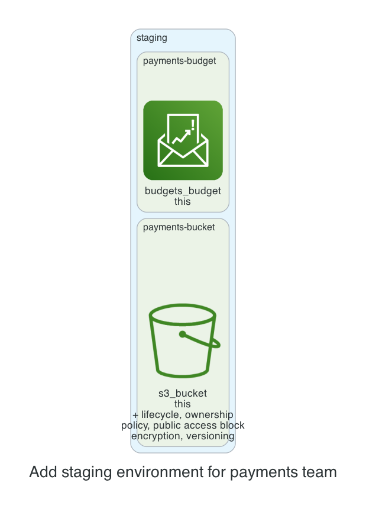

# 0001. Add staging environment for payments team

- Status: Proposed
- Date: 2026-11-13
- Deciders: _(the reviewer: name yourself, then set Status to Accepted or Rejected)_
- Request: "a staging environment for team payments with a private bucket and a $200 budget"

## Context and problem statement

The team requested a staging environment for payments that includes a private S3 bucket and a $200 monthly budget. A decision is required to determine how to provision these resources while adhering to cost, security, and kit policies.

## Considered options

- **Option A**: Create a single S3 bucket with default private settings and a budget module with a $200 limit, using the kit’s standard modules.
- **Option B**: Create a dedicated S3 bucket with a custom bucket policy that allows only the staging IAM role, and a budget module with a $200 limit, adding an additional lifecycle rule for data archival.
- **Option C**: Create a private S3 bucket and a separate budget module, but also enable KMS encryption for the bucket to meet stricter security requirements.

## Decision outcome

Chosen option: **Option A**. Option A satisfies the requirement with the minimal configuration, keeping costs low and aligning with the kit’s default security posture (private bucket, SSE‑S3, lifecycle). It meets the $200 budget constraint and avoids unnecessary complexity or extra costs from custom policies or KMS.

### Consequences

- Good: Simple implementation, quick deployment, minimal maintenance. 
Good: Cost predictable with $200 cap. 
Bad: No role‑based access control beyond bucket privacy. 
Bad: No additional encryption layer beyond SSE‑S3.

_The sections above were drafted by the model; check them. The section below is generated from the plan by code._

## Facts from the plan

| Unit | Env | Module | Add | Change | Destroy |
|---|---|---|---|---|---|
| payments-bucket | staging | s3-bucket | 7 | 0 | 0 |
| payments-budget | staging | budget | 1 | 0 | 0 |

Policies: 2 of 2 plan files pass all 5 Kyverno policies (scripts/check-policies.sh, against a local AWS mock). Nothing was applied.
