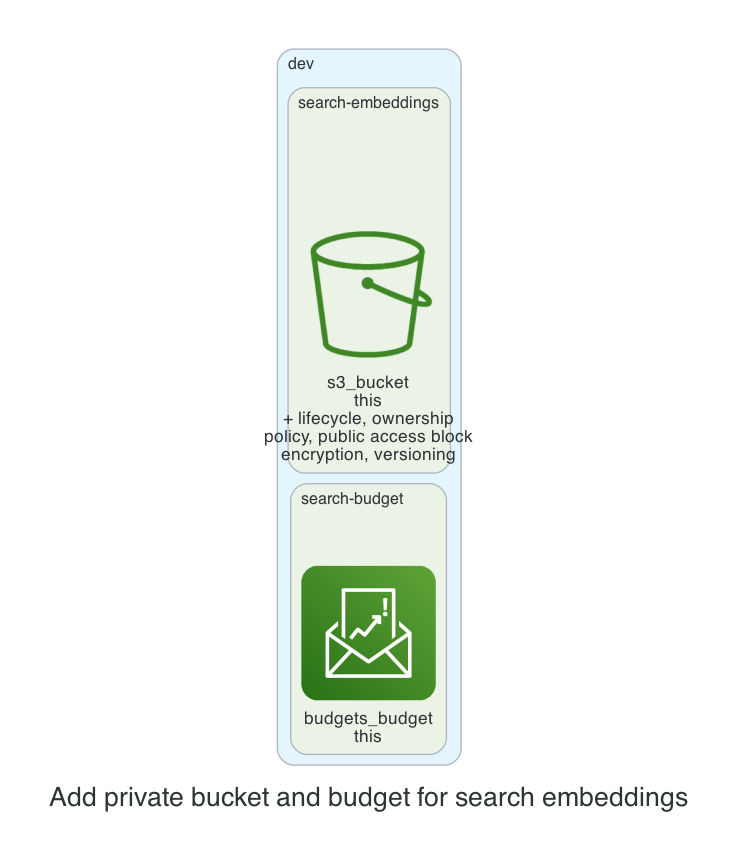

# 0001. Add private bucket and budget for search embeddings

- Status: Proposed
- Date: 2026-11-13
- Deciders: _(the reviewer: name yourself, then set Status to Accepted or Rejected)_
- Request: "Dev: a private bucket for the search team's embeddings, with a $150 monthly budget."

## Context and problem statement

The search team requires a private S3 bucket for embeddings in the dev environment, with a $150 monthly budget cap. A decision is needed to determine how to provision the bucket and budget while adhering to cost, security, and kit policies.

## Considered options

- **Option 1: Single bucket with default tags**: Create one S3 bucket with default tags and a separate budget module for the dev environment.
- **Option 2: Separate bucket per unit with shared budget**: Create a dedicated bucket for each unit and attach a shared budget module to the environment.
- **Option 3: Combined bucket and budget in one module**: Use a custom module that provisions both the bucket and budget together, ensuring tight coupling.

## Decision outcome

Chosen option: **Option 1: Single bucket with default tags**. Option 1 aligns with the kit’s standard modules, keeping the bucket private and encrypted while avoiding unnecessary duplication. It satisfies the $150 budget constraint through the existing budget module and maintains clear tagging for cost allocation.

### Consequences

- Good: Simplifies management, reduces Terraform state size, and follows kit defaults. Bad: Less granularity in cost tracking per unit. Good: No extra IAM roles or policies needed. Bad: Future expansion may require additional buckets, adding complexity later.

_The sections above were drafted by the model; check them. The section below is generated from the plan by code._

## Facts from the plan

| Unit | Env | Module | Add | Change | Destroy |
|---|---|---|---|---|---|
| search-embeddings | dev | s3-bucket | 7 | 0 | 0 |
| search-budget | dev | budget | 1 | 0 | 0 |

Policies: 6 of 6 plan files pass all 5 Kyverno policies (scripts/check-policies.sh, against a local AWS mock). Nothing was applied.
