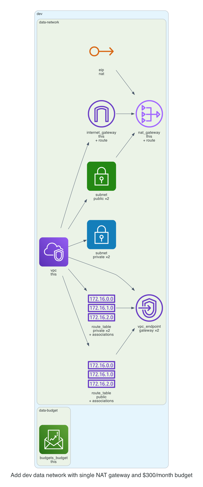

# 0001. Add dev data network with single NAT gateway and $300/month budget

- Status: Proposed
- Date: 2026-11-13
- Deciders: _(the reviewer: name yourself, then set Status to Accepted or Rejected)_
- Request: "Give the data team in dev a network across two availability zones with one NAT gateway, and a budget of $300 a month."

## Context and problem statement

The data team in the dev environment requires a VPC spanning two availability zones with a single NAT gateway, and a monthly budget cap of $300. A decision is needed to select the appropriate Terraform modules and configurations that satisfy these constraints while adhering to the kit’s policies.

## Considered options

- **Option A**: Deploy the network module with two AZs and single NAT gateway, and the budget module with a $300 limit. This matches the requested inputs exactly.
- **Option B**: Deploy the network module with two AZs but use a per-az NAT strategy, and set a higher budget of $500 to accommodate potential growth.
- **Option C**: Deploy a single AZ network with no NAT gateway and a $150 budget, reducing cost but limiting availability.

## Decision outcome

Chosen option: **Option A**. Option A directly satisfies the data team’s requirement for two AZs and a single NAT gateway, ensuring high availability and cost control. The $300 budget aligns with the financial policy and provides a clear cost ceiling, while the kit’s default budget alerts will monitor usage.

### Consequences

- Good: High availability across two AZs, single NAT reduces egress cost, clear budget cap.
- Bad: Slightly higher upfront cost for the NAT gateway compared to per-az strategy, but within the $300 limit.

_The sections above were drafted by the model; check them. The section below is generated from the plan by code._

## Facts from the plan

| Unit | Env | Module | Add | Change | Destroy |
|---|---|---|---|---|---|
| data-network | dev | network | 20 | 0 | 0 |
| data-budget | dev | budget | 1 | 0 | 0 |

Policies: 6 of 6 plan files pass all 5 Kyverno policies (scripts/check-policies.sh, against a local AWS mock). Nothing was applied.
