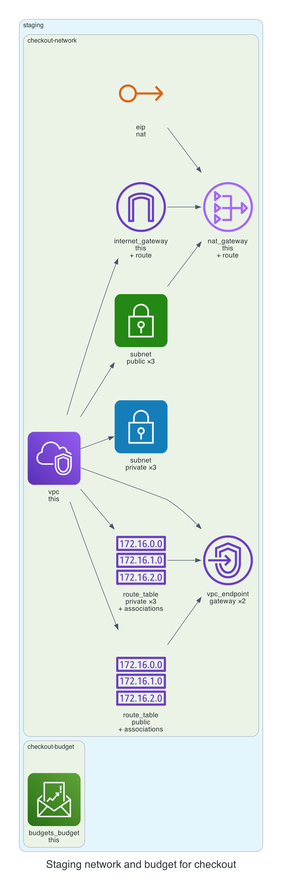

# 0001. Staging network and budget for checkout

- Status: Proposed
- Date: 2026-11-13
- Deciders: _(the reviewer: name yourself, then set Status to Accepted or Rejected)_
- Request: "Staging network for team checkout with 3 availability zones; budget $400."

## Context and problem statement

The team requested a staging network for the checkout service spanning three availability zones with a $400 monthly budget. A decision is required to select the appropriate VPC and NAT configuration that satisfies cost, security, and kit policies.

## Considered options

- **Single NAT Gateway**: Deploy one NAT gateway in a single AZ with public and private subnets across all three AZs, using the kit’s default NAT strategy.
- **Multi-AZ NAT Gateways**: Deploy a NAT gateway in each AZ, providing high availability but higher cost.
- **No NAT Gateway (Private Only)**: Use only private subnets with no NAT, relying on VPC endpoints for S3 and DynamoDB.

## Decision outcome

Chosen option: **Single NAT Gateway**. The single NAT gateway meets the $400 budget while still providing connectivity to the internet for the staging environment. It aligns with the kit’s policy of using a single NAT strategy for cost‑effective deployments and maintains the required security posture by limiting public exposure.

### Consequences

- Good: Lower cost, simpler management, meets budget constraints.
- Good: Fewer resources reduce attack surface.
- Bad: Single point of failure for outbound traffic.
- Bad: Slightly higher latency for traffic routed through one AZ.

_The sections above were drafted by the model; check them. The section below is generated from the plan by code._

## Facts from the plan

| Unit | Env | Module | Add | Change | Destroy |
|---|---|---|---|---|---|
| checkout-network | staging | network | 26 | 0 | 0 |
| checkout-budget | staging | budget | 1 | 0 | 0 |

Policies: 2 of 2 plan files pass all 5 Kyverno policies (scripts/check-policies.sh, against a local AWS mock). Nothing was applied.
