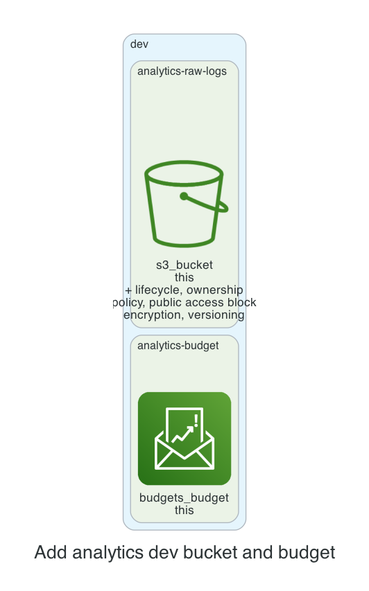

# 0001. Add analytics dev bucket and budget

- Status: Proposed
- Date: 2026-11-13
- Deciders: _(the reviewer: name yourself, then set Status to Accepted or Rejected)_
- Request: "Team analytics needs a dev bucket for raw logs that keeps old versions for 30 days, and a $120 budget."

## Context and problem statement

The analytics team requires a development S3 bucket to store raw logs with a 30‑day version retention policy and a separate AWS Budget set to $120 per month. A decision is needed to determine how to provision these resources while adhering to the kit’s security and cost policies.

## Considered options

- **Option A**: Create a single S3 bucket with versioning and a lifecycle rule that expires non‑current versions after 30 days, and attach a dedicated budget with a $120 limit.
- **Option B**: Create two separate S3 buckets: one for raw logs with versioning and 30‑day retention, and another for processed data without versioning, each with its own budget.
- **Option C**: Use a single S3 bucket with versioning and a 30‑day lifecycle, but apply a bucket policy that restricts access to the analytics team only, and share the budget across all dev buckets.

## Decision outcome

Chosen option: **Option A**. Option A aligns with the kit’s default S3‑bucket module, ensuring public access is blocked, encryption is enabled, and lifecycle is set to Intelligent‑Tiering. It meets the 30‑day retention requirement without extra buckets, keeping costs low and simplifying budget tracking under the $120 limit.

### Consequences

- Good: Simplifies management, reduces resource count, and keeps costs predictable. Bad: All logs share the same bucket, which could complicate access control if other teams need separate buckets. Good: Budget is scoped to the bucket, providing clear cost visibility. Bad: Lifecycle transition to Intelligent‑Tiering may delay access to older logs if needed urgently.

_The sections above were drafted by the model; check them. The section below is generated from the plan by code._

## Facts from the plan

| Unit | Env | Module | Add | Change | Destroy |
|---|---|---|---|---|---|
| analytics-raw-logs | dev | s3-bucket | 7 | 0 | 0 |
| analytics-budget | dev | budget | 1 | 0 | 0 |

Policies: 6 of 6 plan files pass all 5 Kyverno policies (scripts/check-policies.sh, against a local AWS mock). Nothing was applied.
