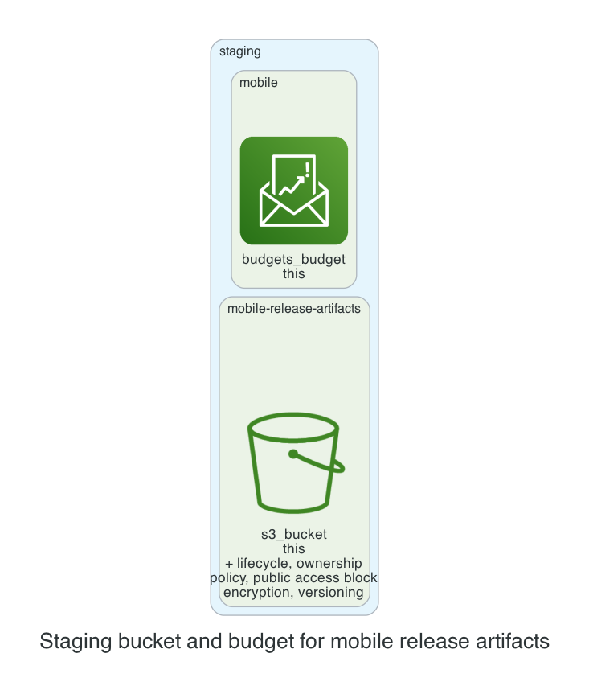

# 0001. Staging bucket and budget for mobile release artifacts

- Status: Proposed
- Date: 2026-11-13
- Deciders: _(the reviewer: name yourself, then set Status to Accepted or Rejected)_
- Request: "Staging bucket for team mobile's release artifacts, $80/month budget."

## Context and problem statement

The team requires a dedicated S3 bucket in the staging environment to store mobile release artifacts, with a strict monthly budget of $80. A decision is needed on how to provision the bucket and budget while adhering to the kit’s security and cost policies.

## Considered options

- **Option 1: Single bucket with default security**: Create one S3 bucket with the kit’s default settings and attach a budget module for the entire staging environment.
- **Option 2: Separate bucket per artifact type**: Create a dedicated bucket for mobile release artifacts and a separate budget module for that bucket only.
- **Option 3: Shared bucket with lifecycle policies**: Use a shared staging bucket for all artifacts, apply lifecycle rules to move data to Intelligent-Tiering, and set a budget for the shared bucket.

## Decision outcome

Chosen option: **Option 2: Separate bucket per artifact type**. Separating the mobile release artifacts into their own bucket ensures tighter access control and clearer cost attribution, aligning with the kit’s policy of public access blocked and bucket-owner ownership. The dedicated budget module limits spending to $80, providing precise cost monitoring without affecting other staging resources.

### Consequences

- Good: Clear separation of data and costs, easier compliance audits; Bad: Slightly more administrative overhead to manage an extra bucket; Good: Lifecycle to Intelligent-Tiering reduces storage costs; Bad: Requires additional IAM policies for bucket access.

_The sections above were drafted by the model; check them. The section below is generated from the plan by code._

## Facts from the plan

| Unit | Env | Module | Add | Change | Destroy |
|---|---|---|---|---|---|
| mobile-release-artifacts | staging | s3-bucket | 7 | 0 | 0 |
| mobile | staging | budget | 1 | 0 | 0 |

Policies: 2 of 2 plan files pass all 5 Kyverno policies (scripts/check-policies.sh, against a local AWS mock). Nothing was applied.
