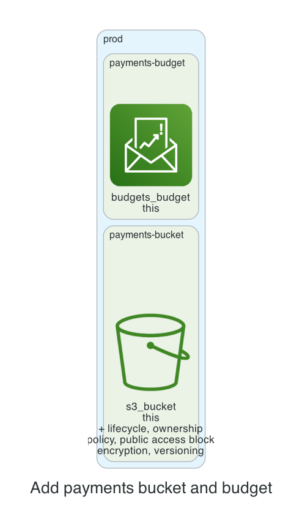

# 0001. Add payments bucket and budget

- Status: Proposed
- Date: 2026-11-13
- Deciders: _(the reviewer: name yourself, then set Status to Accepted or Rejected)_
- Request: "Prod bucket for team payments' invoices, with a $1000 budget." (labels: prod-approved)

## Context and problem statement

The team requires a new S3 bucket in production to store payment invoices, and a corresponding AWS Budget to cap spending at $1,000 per month. A decision is needed to select the appropriate bucket configuration and budget setup that aligns with cost, security, and the kit’s policies.

## Considered options

- **Option A**: Create a private S3 bucket with default encryption (SSE‑S3), versioning, lifecycle to Intelligent‑Tiering, and a budget with 80% and 100% alerts.
- **Option B**: Create a private S3 bucket with SSE‑KMS encryption using a customer‑managed key, versioning, lifecycle to Intelligent‑Tiering, and a budget with 80% and 100% alerts.
- **Option C**: Create a private S3 bucket with default settings and a budget that only triggers at 100% usage, omitting the 80% alert.

## Decision outcome

Chosen option: **Option A**. Option A meets the kit’s default security posture (public access blocked, SSE‑S3, versioning, lifecycle) while keeping costs minimal by avoiding KMS overhead. The 80% and 100% budget alerts provide early warning and enforce the $1,000 cap, satisfying cost‑control policies.

### Consequences

- Good: Simplified configuration, lower encryption cost, early budget alerts; Bad: No customer‑managed key for stricter compliance, no 80% alert if Option C chosen

_The sections above were drafted by the model; check them. The section below is generated from the plan by code._

## Facts from the plan

| Unit | Env | Module | Add | Change | Destroy |
|---|---|---|---|---|---|
| payments-bucket | prod | s3-bucket | 7 | 0 | 0 |
| payments-budget | prod | budget | 1 | 0 | 0 |

Policies: 6 of 6 plan files pass all 5 Kyverno policies (scripts/check-policies.sh, against a local AWS mock). Nothing was applied.
