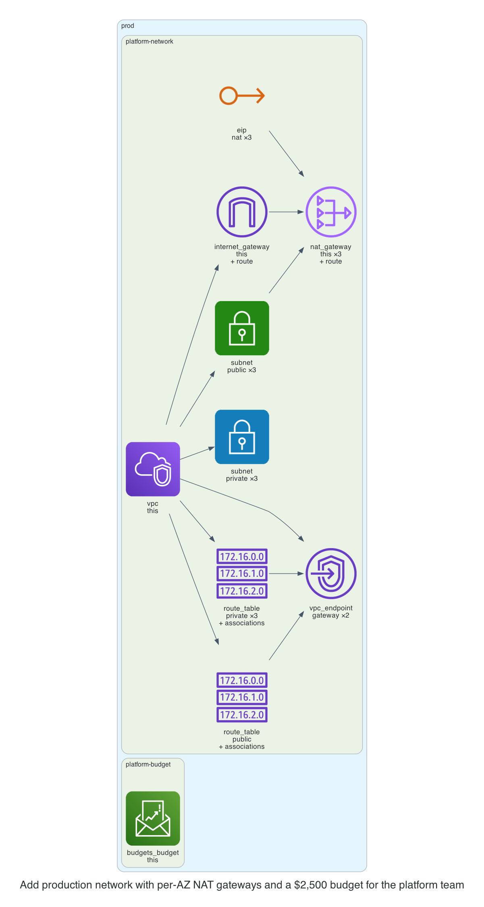

# 0001. Add production network with per‑AZ NAT gateways and a $2,500 budget for the platform team

- Status: Proposed
- Date: 2026-11-13
- Deciders: _(the reviewer: name yourself, then set Status to Accepted or Rejected)_
- Request: "Prod network for team platform with a NAT gateway in each of three AZs, budget $2500." (labels: prod-approved)

## Context and problem statement

The team requested a production network for the platform with a NAT gateway in each of three availability zones and a monthly budget of $2,500. A decision is required to select the appropriate NAT strategy and budget configuration that aligns with cost, security, and the kit’s policies.

## Considered options

- **Single NAT Gateway**: Deploy a single NAT gateway in one AZ and route all private subnet traffic through it.
- **Per-AZ NAT Gateways**: Deploy a NAT gateway in each of the three AZs, providing high availability and reduced cross-AZ traffic.
- **No NAT Gateways (VPC Endpoints Only)**: Rely solely on S3 and DynamoDB gateway endpoints, eliminating NAT gateways entirely.

## Decision outcome

Chosen option: **Per-AZ NAT Gateways**. Per-AZ NAT gateways meet the high-availability requirement and keep traffic within the same AZ, reducing latency and cross-AZ data transfer costs. This approach also satisfies the kit’s security policy of isolating private subnets while staying within the $2,500 budget through efficient resource allocation.

### Consequences

- Good: Improved fault tolerance and lower cross-AZ traffic; Bad: Slightly higher upfront cost for multiple NAT gateways; Good: Simplifies compliance with the kit’s NAT strategy policy; Bad: Requires more monitoring to ensure all NAT gateways remain healthy.

_The sections above were drafted by the model; check them. The section below is generated from the plan by code._

## Facts from the plan

| Unit | Env | Module | Add | Change | Destroy |
|---|---|---|---|---|---|
| platform-network | prod | network | 30 | 0 | 0 |
| platform-budget | prod | budget | 1 | 0 | 0 |

Policies: 6 of 6 plan files pass all 5 Kyverno policies (scripts/check-policies.sh, against a local AWS mock). Nothing was applied.
