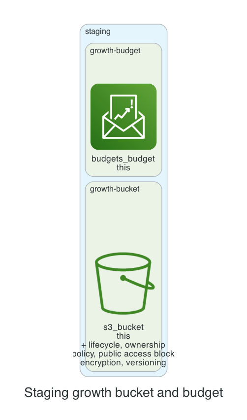

# 0001. Staging growth bucket and budget

- Status: Proposed
- Date: 2026-11-13
- Deciders: _(the reviewer: name yourself, then set Status to Accepted or Rejected)_
- Request: "Staging: team growth wants a bucket that moves objects to intelligent tiering after 60 days, and a $90 budget with alerts to growth-finops@example.com."

## Context and problem statement

The team requested a new S3 bucket for staging that automatically transitions objects to Intelligent‑Tiering after 60 days, and a $90 monthly budget with alerts to the growth‑finops team. A decision is required to determine how to implement these requirements using the available kit modules.

## Considered options

- **Option A**: Create a single s3‑bucket unit with lifecycle rule set to Intelligent‑Tiering after 60 days, and a separate budget unit with a $90 limit and alerts to growth‑finops@example.com.
- **Option B**: Create a single s3‑bucket unit with a lifecycle rule to transition to Intelligent‑Tiering after 60 days, and embed the budget configuration directly into the same unit using a custom module that combines s3‑bucket and budget functionality.
- **Option C**: Create a single s3‑bucket unit with a lifecycle rule to transition to Intelligent‑Tiering after 60 days, and use the existing budget module to create a budget that references the bucket’s cost automatically, without specifying a separate budget unit.

## Decision outcome

Chosen option: **Option A**. Option A keeps the bucket and budget concerns separate, aligning with the kit’s modular design and simplifying future maintenance. It satisfies the cost‑control requirement with a $90 limit and provides clear alerting to the growth‑finops team, while the bucket’s lifecycle rule meets the data‑management policy for Intelligent‑Tiering after 60 days.

### Consequences

- Good: Clear separation of concerns, easier to audit and modify each component independently.
- Good: Meets cost‑control and data‑management policies without custom code.
- Bad: Requires two separate units, slightly more configuration effort.
- Bad: Slightly higher operational overhead due to managing two separate resources.

_The sections above were drafted by the model; check them. The section below is generated from the plan by code._

## Facts from the plan

| Unit | Env | Module | Add | Change | Destroy |
|---|---|---|---|---|---|
| growth-bucket | staging | s3-bucket | 7 | 0 | 0 |
| growth-budget | staging | budget | 1 | 0 | 0 |

Policies: 2 of 2 plan files pass all 5 Kyverno policies (scripts/check-policies.sh, against a local AWS mock). Nothing was applied.
