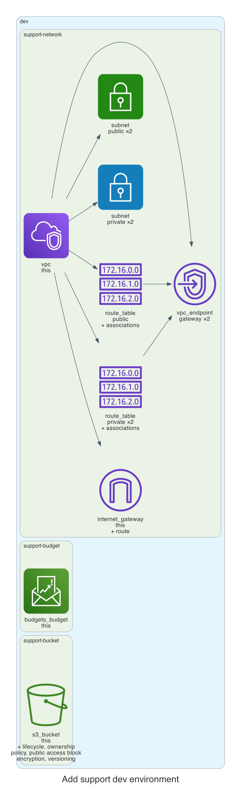

# 0001. Add support dev environment

- Status: Proposed
- Date: 2026-11-13
- Deciders: _(the reviewer: name yourself, then set Status to Accepted or Rejected)_
- Request: "A dev environment for team support: a network with no NAT gateway, a private bucket, and a $60 budget."

## Context and problem statement

The team requested a dev environment for support that includes a network without a NAT gateway, a private S3 bucket, and a $60 monthly budget. A decision is required to select the appropriate configuration that satisfies cost, security, and kit policy constraints.

## Considered options

- **Option A**: Create a VPC with two public subnets and two private subnets, no NAT gateway, and a private S3 bucket with default encryption and versioning. Budget set to $60.
- **Option B**: Create a VPC with a single public subnet and a single private subnet, no NAT gateway, and a private S3 bucket with KMS encryption. Budget set to $60.
- **Option C**: Create a VPC with public and private subnets, but enable a single NAT gateway for outbound traffic, and a private S3 bucket. Budget set to $60.

## Decision outcome

Chosen option: **Option A**. Option A meets the requirement of no NAT gateway, keeps the bucket private, and aligns with the kit’s default encryption and lifecycle policies. It also stays within the $60 budget while providing sufficient subnet separation for future scaling. The chosen design balances cost, security, and compliance with the kit’s standard modules.

### Consequences

- Good: No NAT gateway reduces cost and attack surface; bucket is private and encrypted; budget is enforced. 
- Bad: No outbound internet access limits future services that require external APIs; requires additional VPC endpoints for any needed services. 
- Neutral: Subnet design allows easy addition of resources in the future.

_The sections above were drafted by the model; check them. The section below is generated from the plan by code._

## Facts from the plan

| Unit | Env | Module | Add | Change | Destroy |
|---|---|---|---|---|---|
| support-network | dev | network | 16 | 0 | 0 |
| support-bucket | dev | s3-bucket | 7 | 0 | 0 |
| support-budget | dev | budget | 1 | 0 | 0 |

Policies: 7 of 7 plan files pass all 5 Kyverno policies (scripts/check-policies.sh, against a local AWS mock). Nothing was applied.
