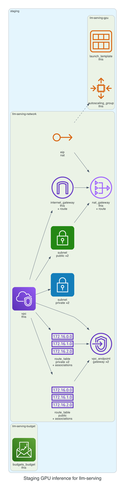

# 0001. Staging GPU inference for llm-serving

- Status: Proposed
- Date: 2026-11-13
- Deciders: _(the reviewer: name yourself, then set Status to Accepted or Rejected)_
- Request: "Staging GPU inference for team llm-serving, all spot, at most 3 instances, budget $1500."

## Context and problem statement

The team llm-serving requested a staging environment for GPU inference that uses only spot instances, limits the fleet to at most three instances, and stays within a $1500 monthly budget. A decision is required to select the appropriate infrastructure configuration that satisfies cost, security, and kit policy constraints.

## Considered options

- **Option A**: Deploy a single NAT gateway in a public subnet, use the gpu-inference module with spot-only instances (max 3), and set a $1500 budget.
- **Option B**: Deploy two NAT gateways (one per AZ) for higher availability, use the gpu-inference module with spot-only instances (max 3), and set a $1500 budget.
- **Option C**: Deploy a single NAT gateway, use the gpu-inference module with spot-only instances (max 3), but increase the budget to $2000 to allow for potential cost spikes.

## Decision outcome

Chosen option: **Option A**. Option A meets the cost constraint of $1500, adheres to the kit’s policy of using spot instances only, and satisfies security requirements by enabling IMDSv2 and encrypting the root volume. It also aligns with the network module’s default single NAT strategy, simplifying the architecture while keeping costs predictable.

### Consequences

- Good: Keeps costs within budget, reduces complexity, and follows security best practices. Bad: Single NAT gateway may become a bottleneck if traffic spikes, and the lack of a second NAT could reduce high-availability for outbound traffic.

_The sections above were drafted by the model; check them. The section below is generated from the plan by code._

## Facts from the plan

| Unit | Env | Module | Add | Change | Destroy |
|---|---|---|---|---|---|
| llm-serving-network | staging | network | 20 | 0 | 0 |
| llm-serving-gpu | staging | gpu-inference | 2 | 0 | 0 |
| llm-serving-budget | staging | budget | 1 | 0 | 0 |

Policies: 3 of 3 plan files pass all 5 Kyverno policies (scripts/check-policies.sh, against a local AWS mock). Nothing was applied.
