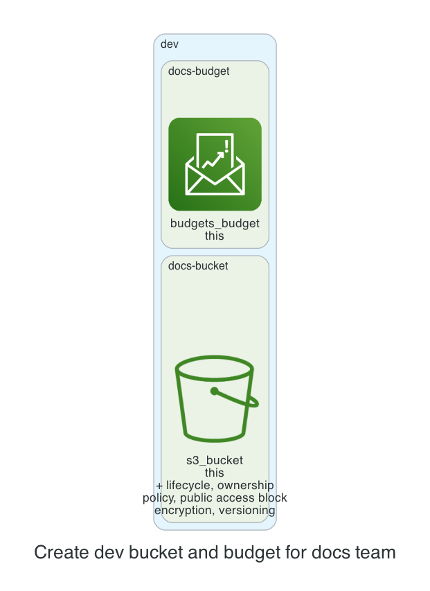

# 0001. Create dev bucket and budget for docs team

- Status: Proposed
- Date: 2026-11-13
- Deciders: _(the reviewer: name yourself, then set Status to Accepted or Rejected)_
- Request: "Dev bucket for team docs with versioning turned off, and a $40 budget."

## Context and problem statement

The team requested a new S3 bucket for development documentation with versioning disabled and a dedicated $40 monthly budget. A decision is required to determine how to provision the bucket and budget while adhering to the kit’s security and cost policies.

## Considered options

- **Option A**: Create a single S3 bucket with versioning disabled and attach a dedicated budget module for $40.
- **Option B**: Create two separate buckets: one for docs with versioning disabled and another for logs with versioning enabled, sharing a single budget.
- **Option C**: Create a single bucket with versioning enabled and use lifecycle rules to delete old objects, then set a $40 budget.

## Decision outcome

Chosen option: **Option A**. Option A satisfies the explicit requirement of disabling versioning, keeps the bucket private by default, and aligns with the kit’s policy of using a dedicated budget per resource. It also avoids unnecessary complexity and cost of additional buckets or lifecycle rules.

### Consequences

- Good: Simplifies management, reduces potential for accidental data loss, and meets cost constraints. Bad: No versioning means no rollback capability for accidental deletions. Good: Budget alerts at 80% and 100% provide early warning of overspend. Bad: Single bucket limits separation of concerns if future needs change.

_The sections above were drafted by the model; check them. The section below is generated from the plan by code._

## Facts from the plan

| Unit | Env | Module | Add | Change | Destroy |
|---|---|---|---|---|---|
| docs-bucket | dev | s3-bucket | 7 | 0 | 0 |
| docs-budget | dev | budget | 1 | 0 | 0 |

Policies: 6 of 6 plan files pass all 5 Kyverno policies (scripts/check-policies.sh, against a local AWS mock). Nothing was applied.
